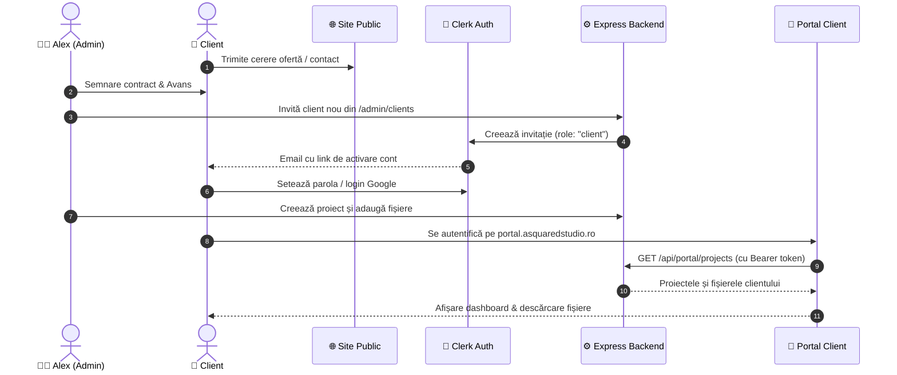

# Documentație Tehnică & Ghid Operațional: Portal Client A Squared Studio

**Data elaborării:** 26 septembrie 2026  
**Autor:** Antigravity AI  
**Componentă:** Portal Client (`WebServices/portal/` + `WebServices/server/src/routes/portal/`)  
**Domeniu Țintă Producție:** `https://portal.asquaredstudio.ro`  
**Port Dezvoltare Locală:** `http://localhost:5175`  
**Fișier PDF asociat:** `Documentatie_Portal_A_Squared_Studio.pdf` (disponibil direct pe Desktop)

---

## 1. Prezentare Generală & Rol în Ecosistem

Portalul de Client este spațiul securizat privat destinat exclusiv clienților agenției **A Squared Studio**. În timp ce:
- **Site-ul public (`asquaredstudio.ro`)** este orientat către atragerea de potențiali clienți și prezentarea serviciilor/portofoliului;
- **Studio Hub (rețeaua privată Tailscale)** este rezervat exclusiv celor 2 administratori interni pentru facturare, scraper leaduri, apeluri și monitorizare;
- **Portalul Client (`portal.asquaredstudio.ro`)** oferă fiecărui client autentificat un dashboard transparent unde își vede stadiul proiectului și fișierele finale livrate.

> [!IMPORTANT]
> **Modelul de Securitate:** Portalul funcționează pe principiul **Invite-Only**. Nu există buton de înregistrare publică liberă (self-signup). Clienții au acces în portal doar după ce sunt invitați explicit pe email de către administrator din panoul de admin.

---

## 2. Arhitectura Tehnică & Tehnologii

### 2.1 Frontend (`WebServices/portal/`)
- **Framework:** React 19.2 + Vite 8.2 + Tailwind CSS v4.
- **Autentificare:** Clerk React (`@clerk/clerk-react`) integrat în `portal/src/main.jsx`.
- **Rute:**
  - `/sign-in/*` — Formular de login minimalist (temă dark).
  - `/` — `Dashboard.jsx` (proiectele clientului curent).
  - `/proiecte/:id` — `ProjectDetail.jsx` (stadiu și fișiere de descărcat).
- **Client API (`portal/src/lib/api.js`):** Extrage automat token-ul Clerk și îl trimite prin header-ul `Authorization: Bearer <token>` către backend.

### 2.2 Backend (`WebServices/server/src/routes/portal/`)
- **Middleware `requireClientAuth.js`:**
  - Validează token-ul transmis cu `@clerk/express`.
  - Verifică ca utilizatorul să aibă rolul `publicMetadata.role === "client"`.
- **Rute REST:**
  - `GET /api/portal/auth/me` — Datele utilizatorului logat.
  - `GET /api/portal/projects` — Proiectele asociate contului clientului (`clerkUserId`).
  - `GET /api/portal/projects/:id` — Proiectul specific cu fișierele atașate.

### 2.3 Baza de Date (PostgreSQL / Prisma)
Tabelele dedicate din `server/prisma/schema.prisma`:
- **`PortalProject`:**
  - `id`: CUID
  - `clerkUserId`: String (ID-ul utilizatorului din Clerk)
  - `name`: Numele proiectului
  - `description`: Descrierea / cerințele
  - `status`: `ACTIVE`, `COMPLETED`, `ARCHIVED`
  - `files`: Relație 1-la-mulți cu `PortalProjectFile`
- **`PortalProjectFile`:**
  - `id`: CUID
  - `projectId`: Cheie externă către `PortalProject`
  - `fileName`: Numele fișierului afișat clientului
  - `r2Key`: Cheia de stocare obiect Cloudflare R2 / S3
  - `size`: Dimensiune în octeți
  - `mimeType`: Tip MIME
  - `uploadedByClerkId`: ID-ul adminului care a urcat fișierul

---

## 3. Fluxul Operațional (User Journey)



---

## 4. Integrarea Portalului pe Site-ul Principal (`asquaredstudio.ro`)

Pentru a oferi clienților o cale directă de acces:

### 4.1 Adăugarea Butonului în Navbar (`src/components/replica/Nav.jsx`)
În fișierul `C:\Users\aldea\OneDrive\Documente\WebServices\src\components\replica\Nav.jsx`:
```jsx
// Buton dedicat în dreapta barei de navigație:
<a
  href="https://portal.asquaredstudio.ro"
  target="_blank"
  rel="noopener noreferrer"
  className="hidden md:inline-flex items-center gap-1.5 px-3.5 py-1.5 rounded-full border border-white/15 bg-white/[0.04] text-[13px] font-medium text-white/80 hover:text-white hover:bg-white/10 hover:border-white/30 transition-all duration-200"
>
  <span className="w-2 h-2 rounded-full bg-emerald-400 animate-pulse" />
  Portal Client
</a>
```

### 4.2 Adăugarea Link-ului în Footer (`src/components/replica/SiteFooter.jsx`)
În fișierul `C:\Users\aldea\OneDrive\Documente\WebServices\src\components\replica\SiteFooter.jsx`:
```jsx
const FOOTER_LINKS = [
  { label: "Acasă", to: "/#hero" },
  { label: "Servicii", to: "/servicii" },
  { label: "Lucrări", to: "/#lucrari" },
  { label: "Prețuri", to: "/preturi" },
  { label: "Portal Client", href: "https://portal.asquaredstudio.ro", external: true },
  { label: "Consultanță gratuită", to: "/discovery" },
];
```

---

## 5. Ghid de Configurare și Variabile de Mediu

### 5.1 Frontend `portal/.env`
```env
VITE_CLERK_PUBLISHABLE_KEY=pk_live_...
VITE_API_BASE_URL=https://api.asquaredstudio.ro/api
```

### 5.2 Backend `server/.env`
```env
CLERK_SECRET_KEY=sk_live_...
CLERK_PUBLISHABLE_KEY=pk_live_...
PORTAL_URL=https://portal.asquaredstudio.ro
```

### 5.3 Găzduire pe Vercel (pentru `portal.asquaredstudio.ro`)
1. În contul Vercel, adăugați proiect nou conectat la `AlinStroie/WebServices`.
2. Setați **Root Directory** la `portal`.
3. Adăugați variabilele de mediu din secțiunea 5.1.
4. Adăugați domeniul `portal.asquaredstudio.ro`.
5. În DNS-ul domeniului `asquaredstudio.ro`, adăugați înregistrarea:
   `CNAME portal -> cname.vercel-dns.com`.

---

## 6. Documentația PDF

Versiunea tipăribilă completă (12 pagini, format A4 vector) a fost generată și plasată în:
1. `C:\Users\aldea\Desktop\Documentatie_Portal_A_Squared_Studio.pdf`
2. `C:\Users\aldea\OneDrive\Documente\WebServices\docs\Documentatie_Portal_A_Squared_Studio.pdf`
3. `C:\Users\aldea\Desktop\A Squared Studio Hub\docs\Documentatie_Portal_A_Squared_Studio.pdf`
